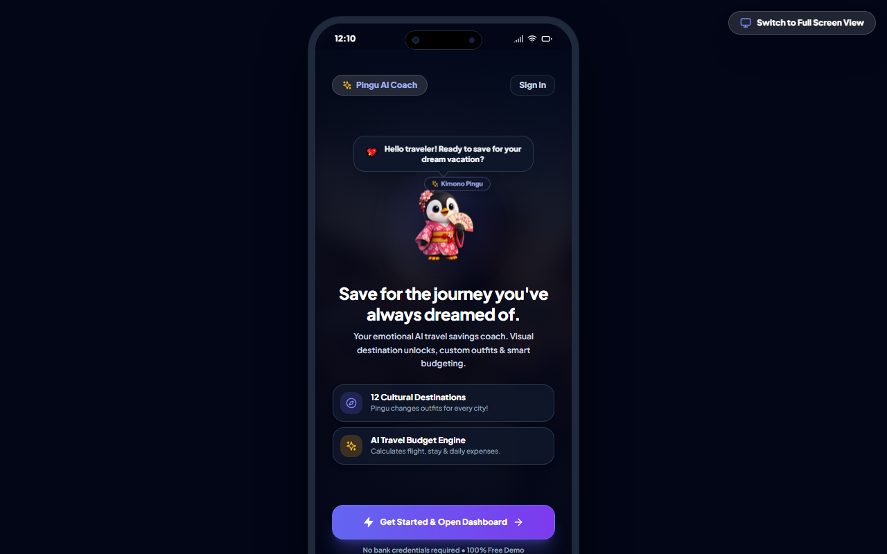

# 🐧 Pingu — Gamified Travel Savings Tracker & Simulated Budget Coach

**Pingu** is an interactive web application designed to help users set, track, and achieve vacation savings goals through gamification, customizable mascot outfits, milestone celebrations, and an interactive budget calculator.



> **ℹ️ Architecture Note regarding AI Coach:**  
> The "AI Coach" feature in this application is currently designed as a **Simulated Budget Coach / Rule-Based Prototype**. It calculates dynamic trip budgets and savings milestones based on destination distance, trip duration, accommodation tier, and dining preferences using algorithmic financial formulas rather than calling a cloud-hosted LLM API.

---

## ✨ Key Features

- **Worldwide Destination Milestones:** Visual milestones for popular travel destinations (Tokyo, Rome, Bali, London, etc.).
- **Interactive Mascot (Pingu):** An animated penguin mascot that responds to deposit progress and dresses in country-themed outfits (Kimono, Gondolier, etc.).
- **Simulated Budget Coach:** Configurable trip planner calculating flight tiers, hotel categories, daily allowances, and target completion dates.
- **Micro-Interactions & Particle Effects:** Confetti animations, sound effects, celebration modals, and glassmorphic UI cards.
- **Local Persistence:** Goal targets, deposit histories, and preferences saved locally in browser `localStorage`.

---

## 🛠 Tech Stack

- **Frontend:** React 18, TypeScript
- **Styling:** Tailwind CSS, PostCSS
- **Bundler:** Vite
- **Icons:** Lucide React
- **Graphics & Animation:** HTML5 Canvas Particle Engine

---

## 🚀 Quick Start

1. Clone the repository and install dependencies:
   ```bash
   npm install
   ```

2. Start the local development server:
   ```bash
   npm run dev
   ```

3. Build for production:
   ```bash
   npm run build
   ```

---

## 🌐 Live Demo

You can try the interactive build in the portfolio showcase:
- **Interactive Demo:** Available inside the [Developer Portfolio](https://github.com/Sturdyshownolove/portfolio) under `pengus-demo/index.html`.

---

## 📄 License

Copyright © 2026 Anıl Aygün. All rights reserved.  
See [LICENSE](LICENSE) for terms of use.
